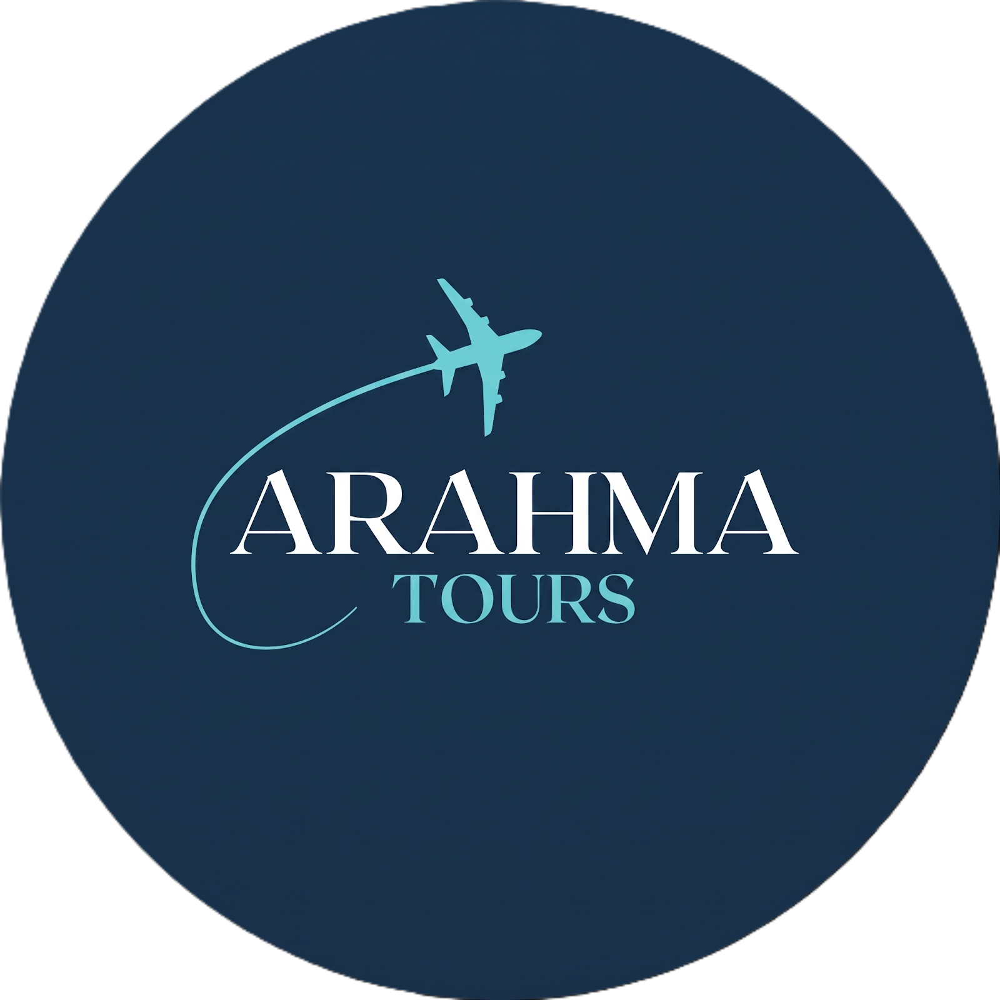

<div align="center">
  
  <h1>Arahma Tours — Vive una Umrah Diferente</h1>
  <p><strong>Experiencia web inmersiva para peregrinaciones exclusivas a la Umrah desde Madrid y Barcelona.</strong></p>

  <p>
    <a href="https://arahmatours.com">🌐 Web Oficial</a> •
    <a href="https://wa.me/34674083320">💬 WhatsApp (+34 674 08 33 20)</a> •
    <a href="LICENSE">📄 Licencia MIT</a>
  </p>
</div>

---

## ✨ Descripción del Proyecto

**Arahma Tours** es una plataforma web interactiva de estilo cinematográfico (*Serene Celestial Journey*) diseñada para presentar los paquetes de peregrinación a La Meca y Medina desde España.

La experiencia combina narrativa visual dividida en **9 capítulos**, un motor de animación secuencial sobre `<canvas>` de 541 fotogramas sincronizado con el desplazamiento (*scroll scrubbing* a 60 FPS), navegación horizontal en escritorio y vertical adaptativa en dispositivos móviles.

---

## 🚀 Características Principales

- **🎬 Motor Canvas Inmersivo (541 Fotogramas):** Secuencia visual (`ezgif-frame-000.jpg` a `ezgif-frame-540.jpg`) renderizada en `<canvas>` con interpolación lineal (*lerp*), carga progresiva por lotes (*batch preloading*) y pantalla de carga (*preloader*) con indicador de progreso en tiempo real.
- **🧭 Navegación Híbrida Inteligente:**
  - **Escritorio (`> 1024px` horizontal):** Recorrido *one-take* horizontal con *scroll-snap*, soporte para rueda del ratón, teclado (`←` / `→`) y barra de progreso flotante inferior con indicador de vuelo.
  - **Móvil y Tablet (`≤ 1024px` o vertical):** Flujo vertical fluido con animaciones de entrada por capítulo.
- **🌍 Soporte Multilingüe Integrado (8 Idiomas):** Selector de banderas personalizado sincronizado con Google Translate (**Español, Árabe, Inglés, Francés, Indonesio, Urdu, Turco y Bengalí**), con soporte automático `RTL` para árabe y urdu sin alterar la estructura espacial de la interfaz.
- **🎨 Sistema de Diseño *Serene Celestial Journey*:**
  - Tokens de color basados en variables CSS (`--surface`, `--primary`, `--secondary`, `--tertiary`).
  - Sistema de espaciado consistente basado en cuadrícula de `8px`.
  - Tipografías editoriales y geométricas: *Playfair Display*, *Plus Jakarta Sans* e *Inter*.
  - Tarjetas con efecto *glassmorphism* (`backdrop-filter: blur`) y micro-interacciones.
- **♿ Accesibilidad y SEO:**
  - HTML5 semántico (`header`, `nav`, `main`, `section`, `aside`).
  - Respeto estricto por `prefers-reduced-motion: reduce`.
  - Metadatos completos Open Graph, Twitter Cards y datos estructurados **Schema.org JSON-LD (`TravelAgency`)**.

---

## 🗺️ Estructura de Capítulos

| Cap. | Identificador | Contenido |
| :--- | :--- | :--- |
| **01** | `inicio` | Hero principal e introducción a la experiencia espiritual |
| **02** | `ruta` | Salida desde España (Madrid / Barcelona) y vuelos |
| **03** | `meca` | Estancia en La Meca y hoteles 5★ frente al Haram |
| **04** | `medina` | Traslado en tren de alta velocidad Haramain y estancia en Medina |
| **05** | `que-incluye` | Detalle completo de servicios incluidos y acompañamiento 24/7 |
| **06** | `fechas` | Calendario de próximas salidas y tarifas |
| **07** | `historia` | Nuestra historia, valores y compromiso con el peregrino |
| **08** | `faq` | Preguntas frecuentes interactivas (acordeón accesible) |
| **09** | `contacto` | Cierre y reserva directa por WhatsApp |

---

## 📁 Estructura del Repositorio

```text
arahmatours/
├── assets/
│   ├── hero/                  # Secuencia de 541 fotogramas (ezgif-frame-000.jpg a 540.jpg)
│   └── images/                # Logotipo e imágenes de marca
├── css/
│   └── style.css              # Tokens CSS, layout híbrido, glassmorphism y reglas RTL/a11y
├── js/
│   └── app.js                 # Motor Canvas 60fps, sincronización de capítulos y selector de idioma
├── index.html                 # Documento principal HTML5 semántico y configuración Tailwind
├── package.json               # Scripts de servidor local con `serve`
└── LICENSE                    # Licencia MIT
```

---

## 🛠️ Instalación y Uso Local

### Requisitos previos
- [Node.js](https://nodejs.org/) (v16 o superior recomendado) o cualquier servidor estático local.

### Ejecución con Node.js / npm

1. Clona el repositorio:
   ```bash
   git clone https://github.com/tu-usuario/arahmatours.git
   cd arahmatours
   ```

2. Instala las dependencias:
   ```bash
   npm install
   ```

3. Inicia el servidor de desarrollo en el puerto `3000`:
   ```bash
   npm run dev
   ```

4. Abre tu navegador en `http://localhost:3000`.

---

## 📐 Reglas de Arquitectura y Estilo

El proyecto sigue estándares estrictos de desarrollo frontend:
1. **HTML5 Semántico:** Uso de etiquetas estructurales y atributos `aria-*` para accesibilidad y SEO.
2. **Variables CSS:** Todos los colores están centralizados en `:root` dentro de `css/style.css`.
3. **Sistema de 8px:** Espaciados y márgenes alineados a una cuadrícula base de `8px`.
4. **Movimiento Reducido:** Todas las animaciones respetan la preferencia del sistema `@media (prefers-reduced-motion: reduce)`.

---

## 📄 Licencia

Distribuido bajo la licencia **MIT**. Consulta el archivo [LICENSE](LICENSE) para más información.

© 2026 **Arahma Tours** — *Oussama Zazou Abid*.

